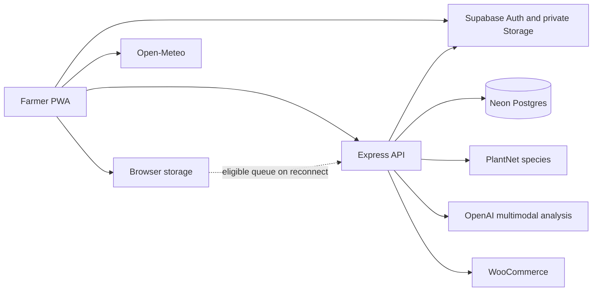

# AI Agropreneur — full platform audit 2026

Audit date: 31 October 2026. Scope: repository source and supplied owner brief.

Evidence convention: paths are repository-relative and line numbers refer to commit `d6fa0099539de3c826752942999215c3f8ecfaae` (worktree clean at inspection). **Implemented** means source present, not verified live. “Unable to verify” covers configuration, deployment, user data and real-world performance. No production queries, paid API calls, migrations, builds or tests were run. This is a static, bounded review; it is not an exhaustive independently verified security audit. No prior security audit ledger was available.

Companion documents provide the detailed inventory, architecture, award evidence and actionable estimates. “Verified” below means verified in source only unless explicitly stated. This review did not inspect live databases, deployments, contractual documents, screenshots or user sessions. The security review is source-only and incomplete: the security-audit skill's independent verification and complete coverage workflow was not completed; findings below are hypotheses requiring isolated validation, not a certification of safety.

## Part A — Executive Summary

### 1. Project Overview
A Malaysian agricultural decision-support SPA combines photo-based analysis, advice, product discovery and farm records. The owner states that KANB, product partners and agricultural professionals are involved; independent records confirming the scope and outcomes of these relationships were not supplied.

### 2. Current Development Status
Many connected workflows exist in source with unit tests, but no runtime test was executed. Deployment configuration is present; availability, settings and data are unverified. Expert review and offline synchronization are partial.

### 3. Key Achievements
Implemented source includes multimodal diagnosis, species identification fallback, uncertainty policy, WooCommerce matching, farm activity and myGAP tools, language selection, PWA configuration and benchmark tooling. Source presence alone is not evidence of adoption or effectiveness.

### 4. Major Findings
A source-grounded cross-user upsert vulnerability hypothesis is the highest immediate concern. Agricultural recommendations have heuristic gates but no verified crop-specific regulatory checks or measured accuracy. Operational expert participation is owner-reported; an integrated expert correction/approval loop was not found. Offline claims must be qualified.

### 5. Overall Assessment
Promising implementation with material safety, security, reliability and evidence gaps. Award readiness is conditional on addressing P0 issues and obtaining credible independent proof.

## Part B — Technical Architecture

### 6. Technology Stack
React/Vite/JavaScript frontend, Express/Node API, Postgres via Neon, Supabase Auth and private Storage, OpenAI and PlantNet, WooCommerce and Open-Meteo (`package.json`, `server/index.js:13-26`, `src/hooks/useWeather.js:111-132`). Model defaults configurable (`server/services/aiService.js:38-39`). Render and Vercel files demonstrate configuration, not production status.

### 7. System Architecture

Detailed data paths and caveats are in `AGROPRENEUR_ARCHITECTURE.md`.

### 8. Database Structure
`neon/migrations/0001_plant_app.sql:7-241` defines profiles, scan_history, mygap_logs, mygap_checklist, daily_notes, plots, order_refs, order_recovery_requests, consultation_leads, product_events, disease_product_rules, diagnosis_training_logs, diagnosis_feedback, scan_followup_events, activity_revisions, diagnosis_expert_labels, ai_usage_counters, ai_analysis_requests and migration tracking. User IDs link records logically to Supabase identities; scans and activities may reference plots. JSONB stores variable results and state. Supabase schemas and RLS policies are also in the repository, but actual deployed schemas and grants were not checked.

### 9. AI Architecture
Images are quality-checked and compressed client-side (`src/hooks/useScanLogic.js:100-170`); server attempts PlantNet species identification then OpenAI vision fallback and multimodal analysis (`server/index.js:486-626`). Prompts, structured JSON, alternative diagnoses and conditional treatment enrichment exist (`server/services/aiService.js:2236-2488,2626-2733`). Confidence is model-derived, not demonstrated calibrated probability. No vector retrieval or automatic model training established.

### 10. External Integrations
PlantNet, OpenAI, Supabase, Neon, WooCommerce and Open-Meteo appear in source. External calls, account settings, uptime and costs were not verified. See architecture companion.

## Part C — Complete Feature Audit

### 11. Feature Inventory
See `AGROPRENEUR_FEATURE_INVENTORY.md` for user workflow, technical components, data, integrations, status, evidence, limitations and recommendations. Status is source-based; comprehensive live verification was not performed.

### 12. AI Disease Assessment
Camera/gallery accepts primary and optional leaf images (`src/components/CameraUpload.jsx:243-307`); quality and retake checks occur before upload. PlantNet provides species context, not disease proof; OpenAI analyses images and generates disease/nutrient and differential information. Rules distinguish retake, review and treatment eligibility (`shared/scanResultPolicy.js:106-140`). History, feedback and follow-up code exists. Treatment enrichment can fall back when a stage fails. Model scores, severity and advice are estimates; image ambiguity, unsupported crops and hallucination are not eliminated by prompts or thresholds. No reliable accuracy metric, representative evaluation dataset or calibrated confidence was verified. `docs/SCAN_QUALITY_PLAN.md:15-48` outlines an independent holdout process.

### 13. Expert Validation
The owner states experts review outputs operationally, but no review records were provided. A label table and file-based benchmark exist (`neon/migrations/0001_plant_app.sql:209-222`, `server/services/expertBenchmarkService.js:17-104`). Admin analytics is not an expert approval/correction workflow (`src/pages/AdminReviewDashboard.jsx:53-115`). No label-writing endpoint or automatic training loop was established.

### 14. Product Recommendations
The active path fetches WooCommerce tags/categories, applies curated disease rules and weighted textual matching to product metadata, deduplicates and ranks matches (`server/index.js:661-806`, `server/services/aiService.js:3490-3564`). It exposes price, availability and links where supplied (`server/services/wooCommerceService.js:23-53`); recommendation events and consultation leads can be stored. This is heuristic matching, not vector search or independently validated product safety. No authoritative registration, crop compatibility, dosage and label verification was established. Avoid claims of discounted prices or savings without comparable dated pricing.

### 15. KANB Integration
Branding, partner imagery and shop links occur in `src/components/AppHeader.jsx:85-88`, `src/components/BottomNav.jsx:60` and `public/assets/partners/`. They support a visible association, not proof of contract, supplier arrangements or access to farmers. Obtain signed letters, agreements, meeting records and testimonials. Future scaling is a possibility, not an achieved result.

### 16. myGAP Functionality
Guide, checklist, logbook, PHI calculator and PDF exist (`src/pages/MyGap.jsx:20-108,107-318`). Logbook uses type and free-text notes (:522-550); separate daily activity data includes chemical, harvest and plot fields (`neon/migrations/0001_plant_app.sql:50-78`). These records may aid preparation and traceability if complete; they do not demonstrate full compliance, official government integration or certification. Structured planting records, supporting-document completeness and official requirements coverage need verification.

### 17. PWA and Offline Capabilities
| Capability | Source assessment |
|---|---|
| Installation / shell | Manifest and Workbox precache (`vite.config.js:72-118`); installation and prior caching untested |
| Previously saved guest data | localStorage/IndexedDB available subject to browser quota and eviction; not tested |
| Guest entry | local record writes and guest queue exist; later account migration is separate and not guaranteed continuous sync (`src/utils/migrations.js:49-159`) |
| Signed-in records | Direct cloud writes can fail offline (`src/utils/localStorage.js:617-625,647-656,757-763`); do not claim all forms queue |
| Queue and conflict | authenticated online event flush and 409 tracking exist (`src/context/AuthContext.jsx:101-120`, `src/utils/syncQueue.js:8-40`); conflict-resolution UI and background sync not established |
| AI, product, fresh weather | network-dependent; no local model inference |
| Offline history/myGAP | local availability depends on ownership, previous storage and loaded assets; end-to-end behavior unverified |

### 18. User Experience
Malay is default, with English and Chinese choices and English fallback (`src/i18n/i18n.jsx:26-42`, `src/components/LanguageSelector.jsx:30-33`). Camera/gallery inputs and a guide exist. Responsive layout, touch sizes, language completeness, accessibility and error comprehension need real-device and farmer testing. Source-visible onboarding has three Next/Finish presses; other interaction counts vary with state and were not measured.

### 19. Other Discovered Features
Encyclopedia, nutrition page, weather/location, farm dashboard, plots, harvest/expense analytics, PDF, order history/recovery, AI advisor, farm insights, SOP, natural-language log parsing, risk prediction, legal pages and admin analytics are in the inventory.

**Journey reconstruction:** A: three informational onboarding screens; registration and farm setup are separate, then scan; not a mandatory linear wizard. B: choose/capture primary image, optional leaf, analyze, inspect result and advice; provider failure or poor photo can interrupt. C: eligible result → heuristic product list → external product/cart or consultation; actual purchase unverified. D: enter activity or myGAP log → local/cloud persistence → report/PDF; incomplete data limits traceability. E: previously cached shell and guest local data may work; reconnection flushes eligible authenticated queue, but guest migration and conflicts need testing. F: assessment → farmer feedback and separate expert benchmark tooling; no demonstrated in-app expert correction-to-updated-guidance chain. Only onboarding's minimum three clicks is source-counted; all other interaction counts require usability observation.

## Part D — Quality Assessment

### 20. Security
**Needs validation, P0:** authenticated generic upsert uses caller-supplied IDs and `ON CONFLICT` update without owner predicate (`server/index.js:193-212`, `server/services/neonDataService.js:94-114`). If the API database role permits the update and another user's ID is known, the path can update and return that row. Validate with two dummy principals in an isolated database, including bulk; add ownership predicate and reject mismatches. Separately, caller-supplied scan IDs and unauthenticated feedback may allow overwriting or contaminating audit evidence under configured cloud logging (`server/index.js:445-474,486-524`, `server/utils/dataCollector.js:38-83,164-171`); verify intended guest semantics and bind writes to a trusted capability. No live exploitation was performed.

Supabase bearer verification, allowlisted data sets, owner-filtered reads, private image policies, Helmet, CORS, rate limits and request limits exist (`server/index.js:81-136,184-188`; `supabase/migrations/20261008151000_scan_images_bucket.sql`). Actual deployment controls, secret handling, file content validation, audit retention, backups, incident response and role grants require review. Personal data, images and location require a documented Malaysian PDPA assessment by qualified counsel; no legal compliance conclusion is made.

### 21. Performance
No measured latency, throughput or cost figures were available. Establish p50/p95/p99 for upload, species lookup, analysis, product search and end-to-end response; measure compressed bytes, retries and per-assessment cost. Use consented synthetic fixtures and an isolated environment, with provider spend authorised separately.

### 22. Reliability
Timeouts, fallback models, error handling, caches and tests exist, but live success rates and recovery have not been measured. Test API failure, malformed responses, incomplete images, app reload, offline writes, reconnect and duplicate delivery. Verify backup restoration, not just backup settings.

### 23. Scalability
Separate services and database are plausible scaling components, but per-instance caches, external model latency, base64 payloads, connection limits and browser storage can constrain throughput. No concurrent-user capacity is established. Load-test with controlled workloads and monitor provider limits and unit cost.

### 24. Known Issues
P0 ownership hypothesis, audit integrity risk, incomplete offline handling, unvalidated chemical safety and absent measured accuracy are documented above. Source tests exist but were not executed; deployment-specific risks and actual failure rates remain unknown.

## Part E — Innovation Assessment

### 25. Technical Innovation
The most defensible claim is the custom orchestration of established multimodal, species identification, uncertainty and recordkeeping components. Provider models and standard PWA integrations are not demonstrated proprietary inventions.

### 26. Business Innovation
Linking diagnosis to partner products and consultation could reduce search friction; affordability, actual transactions and savings are not demonstrated.

### 27. Human-AI Collaboration
Expert involvement is owner-reported. Benchmark and label infrastructure can support independent assessment; application-level feedback-to-correction and automated learning are not established.

### 28. Agricultural Ecosystem
KANB branding and product links exist; operational relationships require independent evidence. The association could facilitate future farmer access subject to confirmed agreements and operational capacity.

### 29. Competitive Differentiation
The combination of crop analysis, advice, product discovery and farm records is distinctive in this repository; no comparative market study was performed, so uniqueness or superiority cannot be claimed.

## Part F — TTIA 2026 Readiness

### 30. Category 5 Requirements Mapping
See `AGROPRENEUR_TTIA_EVIDENCE_MATRIX.md` for all six owner-supplied questions, evidence, gaps, suggested narrative and improvements. Official criteria and eligibility were not independently verified.

### 31. Evidence Inventory
Repository source, migrations, tests and owner-supplied background are available. Tests have not been run; partner documents, live screenshots, independently labelled cases and operating reports were not supplied.

### 32. Measurable Outcomes
No verified values for adoption, accuracy, time saved, cost savings or availability. Counts potentially derivable from stored records require clear timeframes, deduplication, consent and denominators; sync, latency and retention require instrumentation; agricultural effectiveness requires field validation. The evidence matrix details sources and limitations.

### 33. Missing Evidence
Obtain signed partnership and expert participation evidence, farmer pilot consent and baseline, representative labelled images, false-healthy and harmful-advice rates, current pricing comparisons, product label verification, operational metrics and security remediation evidence.

### 34. Recommended Award Narrative
“AI Agropreneur has developed a photo-assisted agricultural decision-support application that combines third-party AI and plant identification services with uncertainty handling, farm records and product discovery. The team reports collaboration with KANB and agricultural professionals; operational impact and diagnostic performance will be presented only where independently documented.” Add verified outcomes and dates when available.

### 35. Submission Readiness Assessment
Evidence-incomplete: a technical demonstration can be prepared, but a strong outcome claim is not yet supported. Remediate and verify critical risks and collect independently corroborated pilot and partner evidence before submission.

## Part G — Action Plan

### 36. P0 Critical Improvements
Fix and verify ownership checks, protect audit/feedback attribution, guard product advice with expert and label validation, and prevent silent offline data loss.

### 37. P1 Important Improvements
Conduct blinded expert benchmarking, establish documented human review, collect award evidence, instrument reliability and improve structured myGAP records and usability.

### 38. P2 Future Enhancements
Scale according to measured demand and consider partner workflows only after agreements, governance and the core platform are sound.

### 39. Recommended Development Roadmap
Priorities, proposed changes, business value, complexity, dependencies, rough effort and evidence paths appear in `AGROPRENEUR_IMPROVEMENT_ROADMAP.md`. Resolve P0 before recruiting a wider pilot, then evaluate and instrument, then expand.

### 40. Final Recommendations
Use conservative source-backed language, protect farmers from unsupported treatment and data loss, independently validate diagnosis and measure outcomes. Treat claims of offline AI, certified myGAP, automatic learning, discounted prices or quantified impact as unsupported until separate evidence establishes them.
