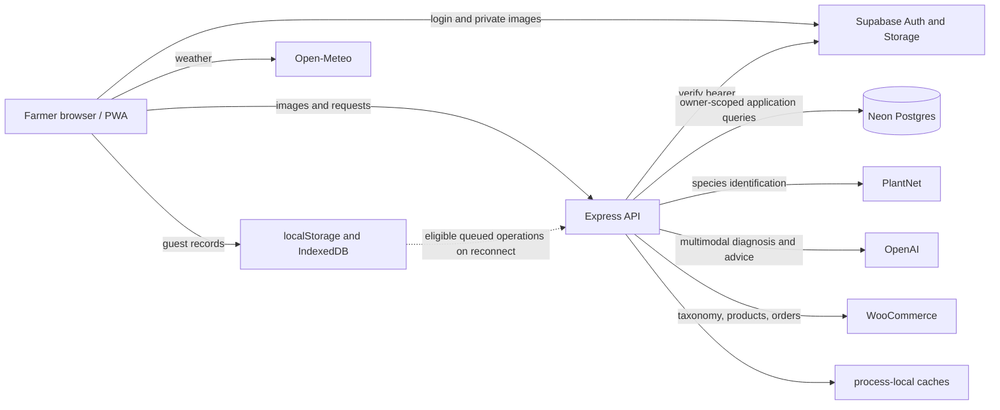

> Historical draft recovered from commit 9f442c7. Not a statement of current deployment or demonstrated outcomes. Verify every claim and complete all placeholders before submission.

# AI Agropreneur — architecture audit

Evidence convention: paths are repository-relative and line numbers refer to commit `d6fa0099539de3c826752942999215c3f8ecfaae` (worktree clean at inspection). **Implemented** means source present, not verified live. “Unable to verify” covers configuration, deployment, user data and real-world performance. No production queries, paid API calls, migrations, builds or tests were run. This is a static, bounded review; it is not an exhaustive independently verified security audit. No prior security audit ledger was available.

React 18, React Router and Vite deliver a JavaScript SPA (`package.json`, `src/AppRoot.jsx:38`). Express/Node serves APIs (`server/index.js`); `pg` accesses Neon. Supabase handles authentication and private scan-image storage; the application API enforces Neon ownership (`server/index.js:180-188`, `src/utils/privateImageStorage.js`). The Supabase schema and migrations are also present, but their presence does not establish that they are the active database. Neon tables include profiles, scans, plots, myGAP logs/checklist, daily activities, order references/recovery, leads, product events, product rules, audit/feedback, follow-ups, revisions, expert labels, usage counters and analysis requests (`neon/migrations/0001_plant_app.sql:7-241`). Some relations are JSONB and user IDs are opaque Supabase identities; plot foreign keys appear at :303-311. Deployed schema, grants and migration state are unknown.

Analysis uses PlantNet for species context with OpenAI vision fallback, then OpenAI multimodal health analysis and conditional treatment enrichment (`server/index.js:486-626`, `server/services/aiService.js:2626-2733`). Defaults are configurable OpenAI models `gpt-5.4-mini` and `gpt-5-mini` (:38-39); actual deployed settings and provider availability are unknown. WooCommerce supplies taxonomy, product and order data; Open-Meteo supplies weather (`src/hooks/useWeather.js:111-132`). Vercel and Render configuration exist (`vercel.json`, `render.yaml`); neither proves an active deployment.

Workbox precaches assets and caches selected resources (`vite.config.js:72-118`); browser storage holds local records and images. Some queue operations flush on an authenticated online event (`src/context/AuthContext.jsx:101-120`, `src/utils/cloudSync.js:6-29`). This is not proof of service-worker background sync. Audit collection is asynchronous in the request path; no durable job broker was established. Process-local analysis and WooCommerce caches do not coordinate across replicas (`server/utils/analysisCache.js`, `server/services/wooCommerceService.js:9-14`). External latency, model costs, JSON image size, database connections and local storage quotas warrant measurement.
